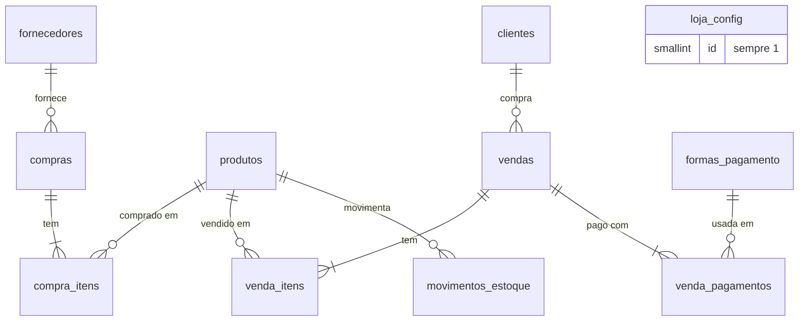

# Banco de dados — N E Baterias

Atualizado em 27/10/2026

O banco tem 11 tabelas, 9 views e 13 funções chamadas pelo app; o esquema completo está em `supabase/schema.sql` e foi testado em PostgreSQL 16, com 20 cenários aprovados (seção 8).

## 1. Nomes e convenções

| Item | Nome sugerido |
| --- | --- |
| Projeto no Supabase | `nebaterias-gestao`, região São Paulo (`sa-east-1`), conta no e-mail da loja |
| Banco / schema | `postgres` / `public` (padrão do Supabase; já exposto na API) |
| Repositório GitHub | `nebaterias-gestao` |
| Endereço do app | `nebaterias-gestao.netlify.app` (separado do site público `nebaterias.vercel.app`) |
| Loja (em `loja_config`) | N E Baterias · (85) 98710-5240 / (85) 99755-5371 · Av. Alberto Magno, 754, Fortaleza - CE · @nebaterias |

| Regra | Exemplo |
| --- | --- |
| Tabelas no plural, `snake_case`, em português | `produtos`, `venda_itens` |
| Chave primária `id uuid` com `gen_random_uuid()` | `vendas.id` |
| Chave estrangeira = tabela no singular + `_id` | `produto_id`, `forma_pagamento_id` |
| Número legível sequencial para pessoas | `vendas.numero`, `compras.numero` |
| Dinheiro `numeric(12,2)`; custo unitário `numeric(12,4)` | `total`, `custo_medio` |
| Data e hora em `timestamptz` (UTC); relatórios convertem para `America/Fortaleza` | `vendas.data_hora` |
| Views começam com `vw_` | `vw_vendas_lista` |
| Funções internas começam com `fn_` | `fn_normalizar` |
| Funções que o app chama: verbo no infinitivo ou `painel_` | `registrar_venda`, `painel_indicadores` |
| Status e tipos como texto com `check` | `status in ('concluida','cancelada')` |

A marca é um campo (`produtos.marca`), e a chave única é marca + modelo, porque a loja também vende Heliar e Zetta.

## 2. Diagrama de relacionamentos



`loja_config` não se relaciona com nada (1 linha com os dados da loja). Os movimentos apontam para a origem (compra, venda ou ajuste) por `origem_tipo` + `origem_id`, sem chave estrangeira.

Compras ficam à esquerda e vendas à direita, e as duas passam por `produtos`. Os movimentos apontam para a compra, venda ou ajuste de origem por `origem_tipo` + `origem_id`, sem chave estrangeira; vendas, compras e movimentos também guardam `usuario_id` (usuário do Supabase Auth que gravou).

## 3. Dicionário de dados

Cadastros (seções 3.1 a 3.5) o app edita direto; movimentos (3.6 a 3.11) só são gravados pelas funções RPC. Toda tabela de cadastro tem `created_at` e `updated_at`, atualizados pelo banco.

### 3.1 `loja_config` — dados da loja (sempre 1 linha, `id = 1`)

| Campo | Tipo | Regra |
| --- | --- | --- |
| nome\_loja, telefone, endereco, instagram, site | text | Aparecem no comprovante |
| garantia\_padrao\_meses | smallint, padrão 12 | 0 a 120; usada quando o produto não tem garantia própria |
| rodape\_comprovante | text | Texto final do comprovante de WhatsApp |

### 3.2 `produtos` — baterias

| Campo | Tipo | Regra |
| --- | --- | --- |
| id | uuid | Chave |
| modelo | text, obrigatório | Único junto com `marca` |
| marca | text, padrão “Moura” | Moura, Heliar, Zetta… |
| linha | text, obrigatório | Moura Moto, Moura EFB, Moura AGM… (filtro da tela Estoque) |
| tipo\_veiculo, aplicacoes | text | Carros atendidos; entram na busca |
| amperagem\_ah | smallint | Maior que 0 |
| preco\_venda, preco\_venda\_sem\_sucata | numeric(12,2) | Com troca da usada / sem troca |
| custo\_medio | numeric(12,4) | **Só o banco altera** (a cada compra) |
| estoque\_atual | integer | **Só o banco altera** (pelos movimentos); pode ficar negativo |
| estoque\_minimo | integer, padrão 1 | Dispara o alerta de estoque baixo |
| garantia\_meses | smallint | Nulo = usa a garantia padrão da loja |
| ativo | boolean | Desativar em vez de apagar |
| busca | text gerado | Marca + modelo + linha + veículos, minúsculo e sem acento |

### 3.3 `fornecedores`

| Campo | Tipo | Regra |
| --- | --- | --- |
| id | uuid | Chave |
| nome | text, obrigatório | Ex.: revendedor Moura |
| telefone, cidade, obs | text |  |
| ativo | boolean |  |

### 3.4 `clientes`

| Campo | Tipo | Regra |
| --- | --- | --- |
| id | uuid | Chave |
| nome | text, obrigatório | Espaços das pontas removidos |
| telefone | text | Guardado só com dígitos (85999991234); usado no link do WhatsApp |
| cpf\_cnpj | text | Só dígitos; opcional |
| veiculo | text | Ex.: Onix 2019 |
| placa | text | Maiúsculas, sem hífen (ABC1D23) |
| obs | text |  |
| busca | text gerado | Nome + telefone + placa + veículo |

### 3.5 `formas_pagamento`

| Campo | Tipo | Regra |
| --- | --- | --- |
| id | uuid | Chave |
| nome | text, único | Dinheiro, Pix, Débito, Crédito |
| taxa\_percentual | numeric(5,2) | Taxa da maquininha, 0 a 100 |
| permite\_parcelas | boolean | Só Crédito vem como `true` |
| ativo, ordem | boolean, smallint | Ordem dos botões na tela de venda |

### 3.6 `compras` — entradas de mercadoria

| Campo | Tipo | Regra |
| --- | --- | --- |
| id, numero | uuid, bigint sequencial | `numero` é o que aparece na tela |
| fornecedor\_id | uuid → fornecedores | Opcional |
| data\_compra | date | Padrão hoje em Fortaleza; não pode ser futura |
| numero\_nota | text | Opcional |
| valor\_produtos | numeric(12,2) | Soma de quantidade × (tabela − desconto) |
| frete, outros\_custos | numeric(12,2) | Rateados entre os itens |
| qtd\_sucata\_entregue, abatimento\_sucata | integer, numeric(12,2) | Abatimento rateado entre os itens |
| total | numeric(12,2) | = valor\_produtos + frete + outros − abatimento (conferido por `check`) |
| status | text | `concluida` ou `cancelada` |
| motivo\_cancelamento, cancelada\_em | text, timestamptz | Preenchidos ao cancelar |
| usuario\_id | uuid → auth.users | Quem lançou |

### 3.7 `compra_itens`

| Campo | Tipo | Regra |
| --- | --- | --- |
| compra\_id, produto\_id | uuid | Chaves estrangeiras |
| quantidade | integer | Maior que 0 |
| preco\_tabela, desconto\_unitario | numeric(12,2) | Desconto não passa do preço |
| rateio\_custos, rateio\_abatimento | numeric(12,2) | Parte do frete e da sucata desta linha |
| custo\_unitario\_final | numeric(12,4) | (linha + rateio\_custos − rateio\_abatimento) ÷ quantidade |
| subtotal | numeric(12,2) | Custo total da linha |

### 3.8 `vendas`

| Campo | Tipo | Regra |
| --- | --- | --- |
| id, numero | uuid, bigint sequencial |  |
| data\_hora | timestamptz | Padrão agora; aceita retroativa, nunca futura |
| cliente\_id | uuid → clientes | Opcional |
| subtotal | numeric(12,2) | Soma de quantidade × preço |
| desconto\_tipo, desconto\_informado | text, numeric | `valor` (R$) ou `percentual` (%) e o número digitado |
| desconto\_total | numeric(12,2) | Desconto efetivo em R$ |
| total | numeric(12,2) | = subtotal − desconto\_total (conferido por `check`) |
| sucata\_recebida | boolean | Cliente entregou a bateria usada |
| tipo\_atendimento | text | `balcao`, `entrega` ou `socorro` |
| local\_atendimento | text | Bairro ou endereço da entrega/socorro |
| status, motivo\_cancelamento, cancelada\_em |  | Como em compras |
| usuario\_id | uuid → auth.users | Quem vendeu |

### 3.9 `venda_itens`

| Campo | Tipo | Regra |
| --- | --- | --- |
| venda\_id, produto\_id | uuid | Chaves estrangeiras |
| quantidade, preco\_unitario | integer, numeric(12,2) |  |
| desconto\_rateado | numeric(12,2) | Parte do desconto da venda nesta linha |
| total\_item | numeric(12,2) | quantidade × preço − desconto\_rateado |
| custo\_unitario | numeric(12,4) | Custo médio no instante da venda (base da margem) |
| garantia\_ate | date | Data da venda + meses de garantia |

### 3.10 `venda_pagamentos`

| Campo | Tipo | Regra |
| --- | --- | --- |
| venda\_id, forma\_pagamento\_id | uuid |  |
| valor | numeric(12,2) | Maior que 0; a soma fecha com o total da venda |
| parcelas | smallint | 1 a 24; acima de 1 só se a forma permitir |
| taxa\_percentual, valor\_taxa | numeric | Taxa gravada no momento da venda |

### 3.11 `movimentos_estoque` — fonte única do saldo

| Campo | Tipo | Regra |
| --- | --- | --- |
| produto\_id | uuid |  |
| data\_hora | timestamptz |  |
| tipo | text | `ENTRADA` (+), `SAIDA` (−), `AJUSTE` (±), `ESTORNO` (±) |
| quantidade | integer | Diferente de zero; o sinal diz se entra ou sai |
| custo\_unitario | numeric(12,4) | Custo da operação |
| origem\_tipo, origem\_id | text, uuid | `compra`, `venda` ou `ajuste` + o id de origem |
| motivo | text | Obrigatório em ajuste e cancelamento |
| usuario\_id | uuid |  |

Um trigger soma cada movimento em `produtos.estoque_atual`, na mesma transação.

## 4. Funções de gravação (RPC)

Toda operação que mexe em estoque é uma única chamada `supabase.rpc(...)`, que grava tudo ou nada; o app nunca faz `insert` em vendas, compras ou movimentos.

| Função | Parâmetros | Retorna | O que faz |
| --- | --- | --- | --- |
| `registrar_venda` | `p` (json da venda), `p_permitir_estoque_negativo` (padrão false) | `{ id, numero, total, lucro_bruto, estoque_negativo }` | Valida, rateia o desconto, grava itens com o custo médio do momento, pagamentos com a taxa, garantia e saída do estoque |
| `registrar_compra` | `p` (json da compra) | `{ id, numero, total }` | Rateia frete e sucata, calcula o custo final, recalcula o custo médio e dá entrada no estoque |
| `cancelar_venda` | `p_venda_id`, `p_motivo` | `{ id, numero, status }` | Marca como cancelada e devolve o estoque (ESTORNO) |
| `cancelar_compra` | `p_compra_id`, `p_motivo` | `{ id, numero, status }` | Marca como cancelada e retira do estoque; não recalcula o custo médio |
| `ajustar_estoque` | `p_produto_id`, `p_quantidade` (+/−), `p_motivo` | `{ estoque_anterior, estoque_atual }` | Ajuste manual com motivo |
| `ping` | — | `"ok <data>"` | Única função liberada sem login; usada pela rotina anti-pausa |

**Exemplo de venda** (10% de desconto, entrega na Aldeota, Pix + dinheiro):

```json
{
  "cliente_id": "<uuid ou null>",
  "desconto_tipo": "percentual",
  "desconto_informado": 10,
  "sucata_recebida": true,
  "tipo_atendimento": "entrega",
  "local_atendimento": "Aldeota",
  "itens": [ { "produto_id": "<uuid M60GD>", "quantidade": 1, "preco_unitario": 450 } ],
  "pagamentos": [
    { "forma_pagamento_id": "<uuid Pix>", "valor": 200 },
    { "forma_pagamento_id": "<uuid Dinheiro>", "valor": 205 }
  ]
}
```

**Exemplo de compra** (2 baterias com desconto, frete de R$ 30 e 2 sucatas abatendo R$ 50):

```json
{
  "fornecedor_id": "<uuid>",
  "data_compra": "2026-10-27",
  "numero_nota": "4521",
  "frete": 30, "outros_custos": 0,
  "qtd_sucata_entregue": 2, "abatimento_sucata": 50,
  "itens": [ { "produto_id": "<uuid>", "quantidade": 2, "preco_tabela": 320, "desconto_unitario": 20 } ]
}
```

**Erros que o app deve tratar** (vêm em `error.message`):

| Mensagem | Quando | O que o app faz |
| --- | --- | --- |
| `ESTOQUE_INSUFICIENTE` | Falta saldo para algum item | Lê `error.details` (lista com modelo, saldo e quantidade pedida), pergunta “vender mesmo assim?” e repete com `p_permitir_estoque_negativo: true` |
| A soma dos pagamentos (R$ x) é diferente do total da venda (R$ y) | Pagamentos não fecham | Mostra a mensagem e volta para a etapa de pagamento |
| Desconto maior que o valor da venda | Desconto inválido | Mostra a mensagem |
| Parcelamento inválido para Pix | Parcelas em forma que não parcela | Mostra a mensagem |
| Usuário não autenticado (código 42501) | Sessão expirou | Volta para o login |
| Esta venda já está cancelada | Toque duplo em cancelar | Atualiza a tela |

As demais validações (quantidade, preço, produto inativo, data futura) usam o código `22023` e já trazem a mensagem pronta em português para exibir.

## 5. Views e funções de consulta

Os números do painel saem prontos do banco, só de vendas com status `concluida`, e as datas são agrupadas no horário de Fortaleza; o celular não soma nada.

**Views** (lidas com `supabase.from('vw_...')`; todas respeitam o RLS de quem consulta)

| View | Uma linha por | Principais colunas | Usada em |
| --- | --- | --- | --- |
| `vw_produtos_estoque` | produto | saldo, `abaixo_minimo`, preço, custo médio, `markup_pct`, `margem_pct`, valor em estoque | Estoque, detalhe do produto |
| `vw_estoque_baixo` | produto no mínimo ou abaixo | modelo, saldo, mínimo | Início, Painel |
| `vw_valor_estoque` | (1 linha) | unidades, valor a custo, valor a preço de venda | Painel |
| `vw_vendas_lista` | venda | número, data, cliente, total, status, itens, pagamentos, lucro bruto e líquido, atendimento | Início, Histórico |
| `vw_venda_itens_detalhe` | item vendido | venda, produto, valor, custo, lucro, garantia até | Comprovante, cliente, exportação |
| `vw_compras_lista` | compra | número, data, fornecedor, total, status, itens | Histórico de entradas |
| `vw_movimentos_detalhe` | movimento | tipo, quantidade, custo, descrição (“Venda nº 12”) | Detalhe do produto |
| `vw_resumo_mensal` | mês | faturamento, CMV, lucro bruto/líquido, taxas, ticket, descontos, margem, markup | Gráfico de 12 meses, melhor mês |
| `vw_ultima_compra_produto` | produto já comprado | data, fornecedor, preço de tabela, desconto e custo da última compra | Entrada (pré-preenche o item) |

**Funções de consulta** (chamadas com `supabase.rpc(...)`)

| Função | Parâmetros | Devolve |
| --- | --- | --- |
| `buscar_produtos` | `p_termo`, `p_linha`, `p_somente_ativos`, `p_limite` | Linhas de `vw_produtos_estoque`; todas as palavras precisam bater, sem acento (“hilux diesel”, “onibus”) |
| `buscar_clientes` | `p_termo`, `p_limite` | Clientes por nome, telefone (com ou sem máscara), placa ou veículo |
| `painel_indicadores` | `p_inicio`, `p_fim` | 1 linha: faturamento, cmv, lucro\_bruto, taxas, lucro\_liquido, margem\_pct, markup\_pct, qtd\_vendas, qtd\_baterias, ticket\_medio, descontos, desconto\_pct |
| `painel_por_forma_pagamento` | `p_inicio`, `p_fim` | forma, nº de vendas, valor, taxas, participação % |
| `painel_top_produtos` | `p_inicio`, `p_fim`, `p_ordenar` (`quantidade`, `faturamento` ou `lucro`), `p_limite` | modelo, quantidade, faturamento, cmv, lucro, margem |
| `painel_por_linha` | `p_inicio`, `p_fim` | linha, quantidade, faturamento, cmv, lucro, margem |
| `painel_por_atendimento` | `p_inicio`, `p_fim` | balcão / entrega / socorro: nº de vendas, faturamento, participação % |

Para a variação contra o período anterior, o app chama `painel_indicadores` duas vezes: o período escolhido e o mesmo número de dias imediatamente antes.

## 6. Consultas prontas por tela

Cada tela usa no máximo 3 chamadas; o arquivo `supabase/consultas.sql` traz o mesmo conteúdo em SQL para testar no SQL Editor, e todas foram executadas com o usuário do app sem erro.

Data de hoje no fuso da loja, usada em todas as telas:

```javascript
const hoje = new Date().toLocaleDateString('sv-SE', { timeZone: 'America/Fortaleza' }); // '2026-10-27'
const inicioDoMes = hoje.slice(0, 8) + '01';
```

### Início

```javascript
// cartões de hoje e do mês
const { data: dia } = await supabase.rpc('painel_indicadores', { p_inicio: hoje, p_fim: hoje }).single();
const { data: mes } = await supabase.rpc('painel_indicadores', { p_inicio: inicioDoMes, p_fim: hoje }).single();
// alerta de estoque baixo
const { data: baixo } = await supabase.from('vw_estoque_baixo').select('id, modelo, estoque_atual, estoque_minimo');
// últimas 5 vendas
const { data: ultimas } = await supabase.from('vw_vendas_lista')
  .select('id, numero, data_hora, cliente_nome, total, status, itens_resumo')
  .order('data_hora', { ascending: false }).limit(5);
```

### Vender

```javascript
// busca de bateria (debounce de 250 ms)
const { data: produtos } = await supabase.rpc('buscar_produtos', { p_termo: texto, p_limite: 20 })
  .select('id, modelo, linha, aplicacoes, estoque_atual, preco_venda, preco_venda_sem_sucata');
// botões de pagamento (carregar 1x e guardar em memória)
const { data: formas } = await supabase.from('formas_pagamento')
  .select('id, nome, permite_parcelas').eq('ativo', true).order('ordem');
// cliente
const { data: clientes } = await supabase.rpc('buscar_clientes', { p_termo: texto, p_limite: 10 });
const { data: novo } = await supabase.from('clientes')
  .insert({ nome, telefone, veiculo, placa }).select('id, nome').single();

// salvar a venda
let { data, error } = await supabase.rpc('registrar_venda', { p: venda, p_permitir_estoque_negativo: false });
if (error?.message === 'ESTOQUE_INSUFICIENTE') {
  const faltas = JSON.parse(error.details); // [{ modelo, estoque_atual, quantidade_pedida }]
  if (confirm(`${faltas[0].modelo}: estoque ficará negativo. Vender mesmo assim?`)) {
    ({ data, error } = await supabase.rpc('registrar_venda', { p: venda, p_permitir_estoque_negativo: true }));
  }
}

// comprovante para WhatsApp
const { data: itens } = await supabase.from('vw_venda_itens_detalhe')
  .select('venda_numero, data_hora, modelo, quantidade, total_item, garantia_ate').eq('venda_id', data.id);
const { data: loja } = await supabase.from('loja_config').select('*').single();
window.open(`https://wa.me/55${cliente.telefone}?text=${encodeURIComponent(texto)}`);
```

### Estoque e consulta rápida

```javascript
const { data } = await supabase.rpc('buscar_produtos', { p_termo: texto || null, p_linha: linha || null });
const { data: produto } = await supabase.from('vw_produtos_estoque').select('*').eq('id', id).single();
const { data: movs } = await supabase.from('vw_movimentos_detalhe')
  .select('data_hora, tipo, quantidade, custo_unitario, descricao')
  .eq('produto_id', id).order('data_hora', { ascending: false }).limit(20);
await supabase.rpc('ajustar_estoque', { p_produto_id: id, p_quantidade: -1, p_motivo: 'Avaria' });
```

### Entrada (compra)

```javascript
const { data: fornecedores } = await supabase.from('fornecedores').select('id, nome').eq('ativo', true).order('nome');
// último preço pago (pré-preenche o item)
const { data: ultimo } = await supabase.from('vw_ultima_compra_produto')
  .select('preco_tabela, desconto_unitario, custo_unitario_final, data_compra')
  .eq('produto_id', id).maybeSingle();
const { data, error } = await supabase.rpc('registrar_compra', { p: compra });
```

### Painel

```javascript
const { data: kpi }      = await supabase.rpc('painel_indicadores', { p_inicio, p_fim }).single();
const { data: kpiAnt }   = await supabase.rpc('painel_indicadores', { p_inicio: iniAnt, p_fim: fimAnt }).single();
const { data: meses }    = await supabase.from('vw_resumo_mensal')
  .select('ano_mes, faturamento, lucro_bruto, lucro_liquido').gte('mes', haOnzeMeses).order('mes');
const { data: melhor }   = await supabase.from('vw_resumo_mensal')
  .select('ano_mes, faturamento').order('faturamento', { ascending: false }).limit(1);
const { data: formas }   = await supabase.rpc('painel_por_forma_pagamento', { p_inicio, p_fim });
const { data: top }      = await supabase.rpc('painel_top_produtos', { p_inicio, p_fim, p_ordenar: 'lucro', p_limite: 10 });
const { data: linhas }   = await supabase.rpc('painel_por_linha', { p_inicio, p_fim });
const { data: atend }    = await supabase.rpc('painel_por_atendimento', { p_inicio, p_fim });
const { data: valorEst } = await supabase.from('vw_valor_estoque').select('*').single();
```

### Histórico e cadastros

```javascript
// vendas do período, 50 por página
const { data } = await supabase.from('vw_vendas_lista').select('*')
  .gte('data_local', p_inicio).lte('data_local', p_fim)
  .order('data_hora', { ascending: false }).range(0, 49);
// detalhe de uma venda
const { data: venda } = await supabase.from('vendas').select(`*, clientes(nome, telefone),
  venda_itens(quantidade, preco_unitario, desconto_rateado, total_item, garantia_ate, produtos(modelo)),
  venda_pagamentos(valor, parcelas, formas_pagamento(nome))`).eq('id', id).single();
await supabase.rpc('cancelar_venda', { p_venda_id: id, p_motivo: motivo });
// compras
const { data: compras } = await supabase.from('vw_compras_lista').select('*')
  .order('data_compra', { ascending: false }).range(0, 49);
// histórico e garantias de um cliente
const { data: hist } = await supabase.from('vw_venda_itens_detalhe')
  .select('venda_numero, data_hora, modelo, total_item, garantia_ate, status')
  .eq('cliente_id', clienteId).order('data_hora', { ascending: false });
// produto: nunca enviar estoque_atual nem custo_medio (o banco recusa)
await supabase.from('produtos').update({ preco_venda: 460, estoque_minimo: 2 }).eq('id', id);
// exportar CSV
const { data: csv } = await supabase.from('vw_venda_itens_detalhe').select('*')
  .gte('data_local', ini).lte('data_local', fim).csv();
```

## 7. Segurança e permissões

O banco bloqueia sozinho o que o app não deve fazer, então um erro no front não corrompe estoque nem custo.

| Quem | Pode | Não pode |
| --- | --- | --- |
| Anônimo (sem login) | Chamar `ping()` | Ler ou gravar qualquer tabela, view ou função |
| Logado (dono e esposa) | Ler todas as tabelas e views; criar e editar clientes, fornecedores, formas de pagamento, produtos (exceto estoque e custo) e a configuração da loja; chamar as funções das seções 4 e 5 | `insert`/`update`/`delete` direto em vendas, compras, itens, pagamentos e movimentos; alterar `estoque_atual` ou `custo_medio`; apagar produtos (desativar com `ativo = false`) |

- RLS ativado nas 11 tabelas, com a política `acesso_autenticado` (logado vê e opera tudo no MVP).
- As views usam `security_invoker = true`, então seguem o RLS de quem consulta.
- As funções de gravação rodam como dono do banco (`security definer`), conferem o login com `auth.uid()` e gravam `usuario_id`.
- O Supabase dá permissão total em tabelas novas; o `schema.sql` retira tudo e devolve só o necessário. **Ao criar tabela nova, repetir os `grant` da seção 8 do arquivo.**

## 8. Instalação, testes e arquivos

O desenvolvedor cria o banco em cerca de 10 minutos rodando dois arquivos no SQL Editor; tudo foi validado antes em PostgreSQL 16 com um simulador do Supabase.

**Passo a passo**

1. Criar o projeto `nebaterias-gestao` no Supabase (região São Paulo) com o e-mail da loja.
2. SQL Editor → rodar `supabase/schema.sql`.
3. SQL Editor → rodar `supabase/seed.sql` (dados da N E Baterias, formas de pagamento e 19 baterias Moura).
4. Authentication → desligar “Allow new users to sign up” e criar os 2 usuários em Users → Add user.
5. Copiar a Project URL e a chave `anon` para as variáveis de ambiente do Netlify.
6. Cadastrar no GitHub os segredos `SUPABASE_URL`, `SUPABASE_ANON_KEY` e `SUPABASE_DB_URL` para ativar a rotina de manutenção (ping a cada 3 dias e backup aos domingos).
7. Antes de usar: preencher as taxas reais da maquininha, confirmar a garantia padrão (12 meses no seed) e cadastrar os modelos Heliar e Zetta.

**Testes executados** (`testes/rodar.sh`, 20 cenários, todos aprovados)

| Cenário | Resultado |
| --- | --- |
| Anônimo tenta ler produtos e painel | Bloqueado; `ping()` funciona |
| Função chamada sem usuário no token | Recusada |
| Insert direto em vendas / update direto de estoque | Recusados |
| Compra 2 × R$ 300 − R$ 20 de desconto | Custo 280, estoque 2 |
| Nova compra 2 × R$ 300 | Custo médio 290, estoque 4 (critério de aceite) |
| Compra com 2 itens, frete R$ 30 e sucata R$ 50 | Rateio fecha nos centavos; total = soma dos itens |
| Venda R$ 450 com 10% e Pix 200 + dinheiro 205 | Total 405, lucro 115, estoque 3 |
| Pagamentos que não fecham com o total | Recusada com mensagem |
| Venda acima do estoque | `ESTOQUE_INSUFICIENTE`; confirmada, saldo −1 |
| Crédito 3x com taxa de 3% | Taxa R$ 33 gravada |
| Pix parcelado | Recusado |
| Cancelar venda (e cancelar 2 vezes) | Estoque volta; 2º cancelamento recusado |
| Ajuste e cancelamento de compra | Saldos corretos |
| Buscas “onix”, “ONIBUS”, “hilux diesel”, placa com hífen, telefone com máscara | Resultados corretos |
| Painel × conferência manual nas tabelas | Faturamento e CMV iguais |

**Arquivos entregues** (pasta do repositório)

| Arquivo | Conteúdo |
| --- | --- |
| `supabase/schema.sql` | Tabelas, índices, triggers, funções, views, RLS e permissões |
| `supabase/seed.sql` | Dados da loja, formas de pagamento e catálogo Moura |
| `supabase/consultas.sql` | As consultas da seção 6 em SQL, para testar no SQL Editor |
| `testes/` | Simulador do Supabase e os 20 cenários (só para teste local) |
| `.github/workflows/manutencao-supabase.yml` | Anti-pausa e backup semanal |
| `README.md` | Resumo de nomes e passo a passo |
