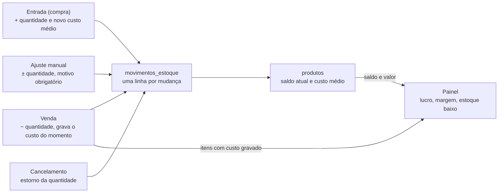

# Sistema de Gestão — N E Baterias

Atualizado em 27/10/2026

## 1. Visão geral

O objetivo é um sistema web interno, leve e pensado para celular, que permita à N E Baterias, loja familiar de Fortaleza, registrar vendas, compras de reposição e clientes, controlar o estoque e acompanhar faturamento, margem e lucro em um painel — com custo zero de infraestrutura.

**Contexto.** A loja já funciona, mas hoje não existe registro de vendas, entradas e saídas de estoque, descontos, formas de pagamento nem cadastro de clientes. Também não há como saber o melhor mês, o lucro real ou quanto se ganha em cada bateria.

**A loja.** A [N E Baterias](https://www.instagram.com/nebaterias/) vende, entrega, instala e socorre baterias automotivas em Fortaleza e Região Metropolitana, das marcas Moura, Heliar e Zetta (carros, motos e outros veículos). Entrega, instalação e check-up elétrico são gratuitos. Endereço: Av. Alberto Magno, 754, Fortaleza - CE. Telefones: (85) 98710-5240 / (85) 99755-5371. Site público: [nebaterias.vercel.app](https://nebaterias.vercel.app/) e [Linktree](https://linktr.ee/nebateriasoficial). O sistema interno é separado do site público.

**Usuários.**

| Usuário | Uso principal | Onde usa |
| --- | --- | --- |
| Dono (também é o vendedor) | Registrar vendas e compras, consultar estoque na hora, inclusive com cliente no telefone | Celular, no balcão e fora da loja |
| Esposa | Acompanhar vendas, estoque, clientes e o painel de resultados | Celular ou computador |

No MVP os dois têm o mesmo nível de acesso (administrador). Não há acesso de clientes externos.

**Premissas.**

- Volume baixo: poucas dezenas de vendas por dia no máximo; o banco deve ficar bem abaixo de 1 GB nos próximos 3 anos.
- Uso 100% interno, por 2 pessoas.
- O sistema não emite nota fiscal e não se integra à maquininha de cartão no MVP.
- Tudo em português do Brasil, valores em reais (R$) e horário de Fortaleza (UTC−3).

## 2. Stack e infraestrutura

A stack é HTML + CSS + JavaScript puro no front, Supabase (plano Free) como banco, login e API, e Netlify (plano Free) como hospedagem — custo mensal R$ 0.

| Camada | Escolha | Por quê |
| --- | --- | --- |
| Front-end | HTML5, CSS3 e JavaScript puro (ES modules), sem framework | Carrega rápido em Android antigo; fácil de manter |
| Banco de dados | Supabase Free (PostgreSQL) | Banco relacional real, com API pronta via `supabase-js` |
| Login | Supabase Auth (e-mail e senha) | Apenas 2 usuários, criados manualmente |
| Regras críticas | Funções SQL (RPC) no Postgres | Venda e compra gravadas em uma única transação |
| Hospedagem | Netlify Free, endereço `*.netlify.app`, deploy a partir do GitHub | Site estático, HTTPS incluso |
| Instalação no celular | PWA (`manifest.json` + service worker) | Ícone na tela inicial do iPhone e do Android, abre como app |
| Gráficos | Chart.js via CDN, carregado só na tela do painel | Leve e suficiente para barras e linhas |

**Limites dos planos gratuitos que o desenvolvedor precisa respeitar** (conferidos em 27/10/2026):

- **Supabase Free:** banco de 500 MB, 5 GB de tráfego por mês e até 2 projetos ativos. Para esta loja, 500 MB comporta muitos anos de vendas.
- **Supabase Free pausa o projeto após 7 dias sem uso**, e é preciso reativá-lo manualmente no painel. Mitigação obrigatória: uma rotina agendada (por exemplo, GitHub Actions) que faz uma consulta leve ao banco a cada 2 ou 3 dias.
- **Supabase Free não tem backup automático.** Ver a seção 9 para a rotina de backup.
- **Netlify Free:** 300 créditos por mês; cada deploy de produção consome 15 créditos (cerca de 20 deploys/mês) e o tráfego consome 20 créditos por GB. Orientação: agrupar alterações e não publicar a cada commit; o tráfego deste sistema é mínimo.

**Repositório e ambientes.** Um repositório no GitHub em nome do dono da loja (o código é dele). Branch `main` publica em produção; demais branches geram pré-visualizações. As chaves do Supabase ficam em variáveis de ambiente do Netlify, nunca no código.

**Estrutura sugerida de pastas.**

```
/index.html            # shell do app + navegação inferior
/css/app.css
/js/app.js             # roteamento por hash (#vender, #estoque…)
/js/supabase.js        # cliente e chamadas
/js/telas/*.js         # uma tela por arquivo
/manifest.json
/sw.js                 # service worker (cache do shell)
/supabase/schema.sql   # tabelas, views, funções e RLS
/supabase/seed.sql     # carga inicial do catálogo
```

## 3. Escopo do MVP

O MVP tem 7 módulos; tudo que envolve nota fiscal, integrações externas e financeiro completo fica para depois.

| # | Módulo | O que entrega |
| --- | --- | --- |
| 1 | Login | Acesso por e-mail e senha, sessão que fica salva no aparelho |
| 2 | Venda | Registrar venda com itens, desconto, forma(s) de pagamento, cliente e data/hora automáticas |
| 3 | Estoque | Saldo por bateria, consulta rápida por modelo ou por carro, alerta de estoque baixo, ajuste manual com motivo |
| 4 | Entrada (compra) | Registrar compra no revendedor: preço de tabela, desconto obtido, custo final, frete; atualiza estoque e custo médio |
| 5 | Cadastros | Produtos (baterias), clientes, fornecedores e formas de pagamento com suas taxas |
| 6 | Painel | Faturamento, custo, lucro, margem, markup, ticket médio, melhor mês, ranking de produtos |
| 7 | Histórico | Lista de vendas e compras com filtro por período, detalhe e cancelamento |

**Fora do escopo do MVP:**

- Emissão de NF-e ou NFC-e.
- Integração com maquininha, banco ou Pix automático.
- Contas a pagar e a receber, fluxo de caixa completo.
- Venda a prazo (fiado) com controle de parcelas a receber — ver pontos em aberto.
- Funcionar sem internet (registrar offline e sincronizar depois).
- App nativo nas lojas (o PWA substitui).
- Vários usuários com permissões diferentes, comissões, várias lojas.

## 4. Telas e fluxos

O app tem uma barra de navegação fixa no rodapé com 5 abas — **Início, Vender, Estoque, Entrada e Painel** — e cada tela deve resolver sua tarefa com o polegar, em poucos toques.

**Navegação.** Roteamento por hash (`#inicio`, `#vender`, `#estoque`, `#entrada`, `#painel`, `#cadastros`). Cadastros (produtos, clientes, fornecedores, formas de pagamento) e Histórico ficam acessíveis por um botão “Mais” no topo da tela Início.

### 4.1 Login

- E-mail e senha; botão “Entrar”. Sem tela de cadastro público.
- A sessão fica salva no aparelho: o dono não deve precisar logar de novo a cada uso.

### 4.2 Início

- Cartões do dia: vendas de hoje (quantidade e R$), lucro de hoje, faturamento do mês.
- Botões grandes: **Nova venda**, **Consultar estoque**, **Nova entrada**.
- Alerta com as baterias abaixo do estoque mínimo.
- Últimas 5 vendas, com toque para abrir o detalhe.

### 4.3 Vender (tela mais importante)

Meta: registrar uma venda comum em menos de 30 segundos.

1. **Buscar bateria** por modelo (“M60”) ou por carro (“Onix”). Cada resultado mostra modelo, linha, saldo em estoque e preço de venda.
2. **Quantidade** (padrão 1) e **preço unitário**, já preenchido com o preço de venda cadastrado e editável.
3. Pode adicionar mais de um item na mesma venda.
4. **Sucata:** “Cliente entregou a bateria usada?” Sim/Não (padrão Sim). Com “Não”, o sistema usa o preço sem troca, se cadastrado. Em seguida, **atendimento**: Balcão, Entrega ou Socorro (padrão Balcão); Entrega e Socorro pedem o bairro ou endereço.
5. **Desconto** no total, em R$ ou %, com alternância por um botão.
6. **Forma de pagamento:** botões grandes (Dinheiro, Pix, Débito, Crédito). Crédito pede o número de parcelas. Opção “Dividir pagamento” para pagar parte em uma forma e parte em outra; a soma deve fechar com o total.
7. **Cliente (opcional):** busca por nome, telefone ou placa; se não existir, cadastro rápido com nome, telefone e veículo/placa.
8. **Resumo e confirmar:** total, desconto, lucro estimado da venda (visível apenas com um toque em “ver lucro”, para não aparecer na frente do cliente).
9. Após salvar: mensagem de sucesso, botão “Nova venda” e botão “Enviar comprovante por WhatsApp” (abre o WhatsApp com um texto pronto: itens, total, forma de pagamento, garantia).

Data e hora são preenchidas automaticamente. Um campo “Data da venda” fica recolhido e permite lançar uma venda de dia anterior.

### 4.4 Estoque e consulta rápida

- Campo de busca no topo, já com o cursor ativo ao abrir. Busca por modelo, linha ou carro/aplicação.
- Lista com modelo, aplicações resumidas, saldo (em vermelho se abaixo do mínimo) e preço de venda.
- Filtros rápidos por linha: Moto, Automotiva, EFB, AGM, Diesel.
- Detalhe do produto: saldo, custo médio, preço de venda, markup e margem atuais, últimas entradas e saídas.
- Botão “Ajustar estoque”: quantidade + motivo obrigatório (contagem, garantia/troca, avaria, outro).
- **Atalho direto:** o endereço `…netlify.app/#estoque` abre direto nesta tela com a busca ativa. Ele também deve aparecer como atalho do PWA (`shortcuts` no manifest), para o dono abrir com o cliente no viva-voz.

### 4.5 Entrada (compra no revendedor)

1. **Fornecedor** (lista; padrão o último usado), **data** (hoje) e **nº da nota** (opcional).
2. **Itens:** bateria, quantidade, preço unitário de tabela e desconto obtido (R$ ou %). O sistema mostra o custo unitário final.
3. **Frete e outros custos** (R$, opcional), divididos entre os itens proporcionalmente ao valor.
4. **Sucata entregue ao fornecedor:** quantidade e valor abatido (R$, opcional), também dividido entre os itens.
5. **Resumo:** total pago, custo final por bateria e como o custo médio de cada uma vai mudar.
6. Confirmar: soma ao estoque e recalcula o custo médio.

### 4.6 Painel

Detalhado na seção 8. Filtro de período no topo: Hoje, 7 dias, Este mês, Mês anterior, Este ano, Personalizado.

### 4.7 Cadastros e Histórico

- **Produtos:** modelo (código), linha, tipo de veículo, aplicações, Ah, preço de venda, preço sem sucata, estoque mínimo, garantia em meses, ativo.
- **Clientes:** nome, telefone/WhatsApp, CPF/CNPJ (opcional), veículo, placa, observações e histórico de compras do cliente.
- **Fornecedores:** nome, telefone, cidade.
- **Formas de pagamento:** nome e taxa (%) cobrada pela maquininha, usada para o lucro líquido.
- **Histórico:** vendas e compras por período, com detalhe e botão **Cancelar** (pede confirmação e motivo).



Toda alteração de estoque passa por um registro de movimento; o painel lê vendas e custos já gravados, nunca recalcula com o custo de hoje.

## 5. Regras de negócio

O estoque é sempre a soma dos movimentos, o custo de cada bateria é o custo médio ponderado, e toda venda guarda o custo do momento para que a margem histórica nunca mude.

**Estoque**

1. Nenhuma tela altera o saldo diretamente. Toda mudança gera uma linha em `movimentos_estoque` (tipo ENTRADA, SAIDA, AJUSTE ou ESTORNO, com quantidade positiva ou negativa).
2. `produtos.estoque_atual` é atualizado pelo banco (trigger ou dentro das funções RPC), na mesma transação do movimento.
3. Venda sem saldo suficiente: o app avisa (“estoque ficará negativo”) e pede confirmação. Não bloqueia, porque o dono pode vender antes de lançar a compra; o saldo negativo aparece em vermelho até ser corrigido.
4. Ajuste manual exige motivo e fica registrado com usuário e data.

**Custo**

5. Custo final de compra por unidade = preço de tabela − desconto + rateio de frete/outros − rateio de abatimento de sucata.
6. Custo médio ponderado, recalculado a cada entrada:

```latex
\text{custo\_medio\_novo} = \frac{\text{saldo\_atual} \cdot \text{custo\_medio\_atual} + \text{qtd\_entrada} \cdot \text{custo\_unitario\_final}}{\text{saldo\_atual} + \text{qtd\_entrada}}
```

7. Se o saldo atual for zero ou negativo, o custo médio novo passa a ser o custo da entrada.
8. Cada item de venda grava `custo_unitario` (o custo médio naquele instante). O painel usa esse valor gravado.

**Preço e desconto**

9. Cada produto tem preço de venda (com troca da sucata) e, opcionalmente, preço sem sucata.
10. O desconto é dado no total da venda, em R$ ou %, e rateado entre os itens proporcionalmente ao valor de cada um, para que a margem por produto fique correta.
11. Se o preço final de um item ficar abaixo do custo, a tela mostra um alerta vermelho antes de confirmar.

**Pagamento**

12. Uma venda pode ter uma ou mais formas de pagamento; a soma dos pagamentos deve ser igual ao total.
13. Cada forma tem uma taxa (%) configurável. A venda grava a taxa do momento e o valor da taxa, usados no lucro líquido.

**Cancelamento e integridade**

14. Venda e compra nunca são apagadas. Cancelar muda o status para `cancelada`, grava motivo e data e gera movimentos de ESTORNO que devolvem (venda) ou retiram (compra) as quantidades.
15. Cancelar uma compra não recalcula o custo médio retroativamente; o desenvolvedor deve apenas registrar o estorno de quantidade.
16. Registrar venda, registrar compra e cancelar são funções SQL (RPC) atômicas: ou grava tudo, ou não grava nada.

**Garantia**

17. Cada produto tem `garantia_meses`. A venda mostra a data de vencimento da garantia (data da venda + meses), que aparece no comprovante e no histórico do cliente.

**Formatos**

18. Valores em `numeric(12,2)` no banco; exibição em R$ 1.234,56. Datas em dd/mm/aaaa. Horário de `America/Fortaleza`.

## 6. Modelo de dados (Supabase / PostgreSQL)

São 11 tabelas, 9 views e 13 funções chamadas pelo app, já escritas e testadas. Nomes, diagrama de relacionamentos, dicionário de dados, funções, permissões e a consulta pronta de cada tela estão em `docs/banco-de-dados.md`.

## 7. Carga inicial do catálogo

O `seed.sql` deve criar 19 produtos, um por modelo da lista Moura levantada pelo dono, com estoque zero, custo zero e preço de venda em branco; preço e custo entram pela primeira compra e pela tela de produtos.

```csv
modelo,linha,tipo_veiculo,aplicacoes
MA5-D,Moura Moto,Motocicletas pequenas,"Honda CG, Honda Biz"
MA6-D,Moura Moto,Motocicletas médias,"Yamaha YBR, Yamaha Fazer"
MA7-E,Moura Moto,Motocicletas grandes,BMW GS
M40SD,Moura Automotiva,Carros pequenos / populares,"Fiat Uno, Chevrolet Celta, Ford Ka, VW Gol 1.0"
M45FD,Moura Automotiva,Carros pequenos / populares,"Fiat Uno, Chevrolet Celta, Ford Ka, VW Gol 1.0"
M60GD,Moura Automotiva,Carros médios / hatches / sedans,"Chevrolet Onix, Hyundai HB20, Fiat Argo, Toyota Corolla, Honda Civic"
M60GE,Moura Automotiva,Carros médios / hatches / sedans,"Chevrolet Onix, Hyundai HB20, Fiat Argo, Toyota Corolla, Honda Civic"
M60AX,Moura EFB,Carros médios com Start-Stop,"VW Polo, Nivus, T-Cross TSI, Jeep Renegade Flex, Fiat Argo, Fiat Cronos"
M72TX,Moura EFB,Carros médios com Start-Stop,"VW Polo, Nivus, T-Cross TSI, Jeep Renegade Flex, Fiat Argo, Fiat Cronos"
M60AD,Moura AGM,Luxo / importados com Start-Stop,"BMW, Mercedes-Benz, Audi, Volvo, Land Rover, VW Jetta, VW Tiguan"
M70LD-AGM,Moura AGM,Luxo / importados com Start-Stop,"BMW, Mercedes-Benz, Audi, Volvo, Land Rover, VW Jetta, VW Tiguan"
M92QD,Moura AGM,Luxo / importados com Start-Stop,"BMW, Mercedes-Benz, Audi, Volvo, Land Rover, VW Jetta, VW Tiguan"
M70LD,Moura Automotiva,SUVs médios e pick-ups (flex / diesel leve),"Jeep Compass, Chevrolet S10 Flex, Toyota Hilux Flex, Hyundai Tucson"
M75LD,Moura Automotiva,SUVs médios e pick-ups (flex / diesel leve),"Jeep Compass, Chevrolet S10 Flex, Toyota Hilux Flex, Hyundai Tucson"
M90TD,Moura Automotiva,"Vans, furgões e grandes utilitários","Renault Master, Fiat Ducato, MB Sprinter, Toyota Hilux Diesel"
M100QD,Moura Automotiva,"Vans, furgões e grandes utilitários","Renault Master, Fiat Ducato, MB Sprinter, Toyota Hilux Diesel"
M150BD,Moura Log Diesel,Caminhões leves e micro-ônibus,"VW Delivery, Ford Cargo leve, Mercedes-Benz Accelo"
M180BD,Moura Log Diesel,"Caminhões pesados, carretas e ônibus","Scania R440, Volvo FH, Mercedes-Benz Axor, Mercedes-Benz Actros"
M220BD,Moura Log Diesel,"Caminhões pesados, carretas e ônibus","Scania R440, Volvo FH, Mercedes-Benz Axor, Mercedes-Benz Actros"
```

**Cuidados na carga:**

- O modelo “M70LD” aparece nas linhas Automotiva e AGM; como marca + modelo é único, a versão AGM foi cadastrada como `M70LD-AGM`.
- A lista veio de pesquisa na internet. Antes de entrar em produção, o dono deve conferir os códigos com a tabela de preços ou notas fiscais do revendedor Moura e incluir os modelos que vende e não estão aqui.
- `amperagem_ah` fica em branco na carga e é preenchida pelo dono, conforme a etiqueta ou a nota.
- `estoque_minimo` sugerido: 1 para todos; o dono ajusta depois.
- O cadastro deve aceitar outras marcas (Heliar, Zetta etc.), pois `marca` é um campo editável.

## 8. Painel e indicadores

O painel responde a três perguntas — quanto vendi, quanto lucrei e o que mais vende — sempre para o período escolhido no filtro, e considera só vendas com status `concluida`.

**Indicadores (cartões no topo)**

| Indicador | Fórmula | Exemplo (1 bateria comprada a R$ 300 e vendida a R$ 450) |
| --- | --- | --- |
| Faturamento | Soma do total das vendas | R$ 450 |
| CMV (custo da mercadoria vendida) | Soma de quantidade × custo\_unitario dos itens | R$ 300 |
| Lucro bruto | Faturamento − CMV | R$ 150 |
| Taxas de pagamento | Soma de valor\_taxa | R$ 13,50 (crédito a 3%) |
| Lucro líquido | Lucro bruto − taxas | R$ 136,50 |
| Margem bruta (%) | Lucro bruto ÷ Faturamento | 33,3% |
| Markup (%) | (Faturamento ÷ CMV) − 1 | 50% |
| Ticket médio | Faturamento ÷ nº de vendas | R$ 450 |
| Desconto concedido | Soma dos descontos e % sobre o bruto | — |
| Nº de vendas e baterias vendidas | Contagem | 1 venda, 1 bateria |

Margem e markup são diferentes e o painel mostra os dois com uma legenda curta: **markup** mede quanto se acrescentou sobre o custo; **margem** mede quanto do preço de venda virou lucro.

Cada cartão mostra a variação contra o período anterior equivalente (ex.: este mês × mês passado), em verde ou vermelho.

**Gráficos e listas**

1. **Faturamento e lucro por mês** (barras, últimos 12 meses), com o **melhor mês** destacado e escrito acima do gráfico (“Melhor mês: …”), tanto por faturamento quanto por lucro.
2. **Vendas por forma de pagamento** (barras horizontais, em R$ e %).
3. **Top 10 baterias** do período, com alternância entre quantidade, faturamento e lucro.
4. **Margem por linha** (Moto, Automotiva, EFB, AGM, Diesel).
5. **Estoque baixo**: lista dos produtos no mínimo ou abaixo, com toque levando à tela de entrada.
6. **Valor do estoque**: soma de estoque\_atual × custo\_medio (quanto dinheiro está parado em bateria).

**Desempenho.** Os números vêm das views do banco (seção 6), já agregados, para o celular não processar listas grandes. O Chart.js só é carregado quando a aba Painel é aberta.

## 9. Requisitos não funcionais, segurança e backup

O app precisa abrir rápido em um Android antigo com internet móvel fraca, ser operável com uma mão e não perder dados mesmo no plano gratuito.

**Desempenho e celular**

- Primeira carga abaixo de 200 KB (sem contar o Chart.js, carregado só no Painel). Sem frameworks e sem bibliotecas de UI pesadas.
- Abrir em até 3 segundos em 4G fraco num Android de entrada; cada tela troca sem recarregar a página.
- Funcionar no Chrome do Android e no Safari do iPhone, nas versões atuais e nas duas anteriores.
- Layout pensado primeiro para tela de 360 px de largura; no computador, centralizado com largura máxima.
- Alvos de toque de no mínimo 48 × 48 px; fonte base de 16 px (evita o zoom automático do iPhone nos campos).
- Campos numéricos com `inputmode="decimal"` e `inputmode="tel"` para abrir o teclado certo.
- Busca com espera de \~250 ms após a digitação (debounce) e limite de 20 resultados.
- Botão de salvar desabilitado durante o envio, para evitar venda duplicada com toque duplo.
- Modo escuro automático, seguindo o celular, e alto contraste para uso no sol.

**Sem internet**

- O service worker guarda a casca do app em cache, para abrir mesmo com sinal ruim.
- Sem conexão, o app mostra um aviso claro e não deixa confirmar venda ou entrada. Registro offline com sincronização fica fora do MVP.

**Segurança**

- RLS em todas as tabelas, cadastro público desligado, só a chave `anon` no front (seção 6).
- Senhas fortes para os 2 usuários; recuperação de senha por e-mail ativa.
- Lucro e custo nunca aparecem na tela de venda sem um toque deliberado (“ver lucro”).

**Backup e continuidade**

- Como o plano gratuito do Supabase não faz backup automático, uma rotina semanal (GitHub Actions) roda `pg_dump` do banco e guarda o arquivo como artefato privado ou em um repositório privado.
- A mesma rotina, ou outra a cada 2–3 dias, faz uma consulta leve para impedir a pausa por inatividade.
- Na tela Mais, botão **Exportar dados (CSV)** para vendas, compras, produtos e clientes, para o dono guardar uma cópia por mês.
- Todo o esquema (`schema.sql`) e a carga (`seed.sql`) ficam versionados no repositório, para recriar o banco do zero se necessário.

## 10. Roteiro de entrega, aceite e pontos em aberto

A entrega é feita em 4 etapas, cada uma testada pelo dono no próprio celular antes de seguir para a próxima.

**Etapas**

1. **Base:** projeto Supabase, `schema.sql` com tabelas, views, funções e RLS, `seed.sql` com o catálogo, login, navegação e PWA instalável publicado no Netlify.
2. **Operação:** cadastros, Entrada (compra), Venda e Estoque com consulta rápida e ajuste.
3. **Gestão:** Painel completo, Histórico com cancelamento, comprovante por WhatsApp, exportação CSV.
4. **Estabilização:** rotinas de backup e anti-pausa, testes em um Android de entrada e em um iPhone, correções e entrega do repositório e dos acessos ao dono.

**Critérios de aceite**

- [ ] O app instala na tela inicial de um Android e de um iPhone e abre já logado.
- [ ] Uma venda de 1 bateria com Pix e cliente já cadastrado é registrada em menos de 30 segundos.
- [ ] O atalho de estoque abre a busca e encontra uma bateria digitando o nome de um carro (ex.: “Onix”).
- [ ] Uma entrada de 2 unidades a R$ 300 sobre 2 unidades em estoque a custo médio R$ 280 deixa o custo médio em R$ 290.
- [ ] Uma venda com desconto de 10% e pagamento dividido (Pix + dinheiro) grava o total correto e o lucro correto no painel.
- [ ] Cancelar uma venda devolve o estoque e a remove do painel.
- [ ] Faturamento, CMV, lucro, margem e markup do painel batem com uma conferência manual em planilha de 10 vendas.
- [ ] Um usuário não logado não consegue ler nenhuma tabela pela API.
- [ ] Existe pelo menos um backup gerado pela rotina semanal.

**Pontos em aberto (decidir com o dono antes ou durante a etapa 2)**

- [ ] A loja vende fiado ou a prazo? Se sim, é preciso um controle de contas a receber (hoje fora do escopo).
- [ ] Quais são as taxas da maquininha por forma de pagamento e nº de parcelas?
- [ ] Qual é a garantia, em meses, de cada linha Moura que a loja pratica?
- [ ] Como funciona a sucata: preço diferente com e sem troca? A sucata é abatida na compra junto ao revendedor?
- [ ] A loja cobra instalação ou outros serviços (teste de bateria, carga)? Se sim, incluir “serviço” como tipo de produto sem estoque.
- [ ] Conferir a lista de modelos e códigos com o revendedor Moura (seção 7).
- [ ] Quem será o dono das contas do GitHub, Supabase e Netlify (recomendado: e-mail da loja)?
- [ ] Entrega e socorro têm cobrança em algum caso (distância, horário)? Hoje o banco registra só o tipo de atendimento e o bairro, sem taxa.

**Fontes** (consultadas em 27/10/2026)

- [Supabase — preços e limites do plano Free](https://supabase.com/pricing)
- [Netlify — limites do plano Free em 2026 (créditos)](https://kuberns.com/blogs/netlify-pricing/)
- [Netlify — modelo de créditos (custo por deploy e por GB)](https://agentdeals.dev/vendor/netlify)
